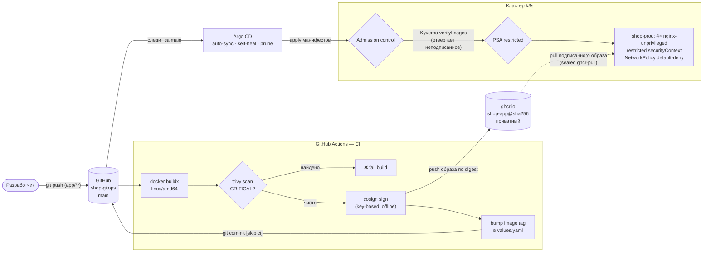

# shop-gitops

**Продакшен-подобный GitOps-репозиторий для развёртывания веб-приложения в Kubernetes (k3s) с полным CI/CD-конвейером и эшелонированной безопасностью.**

Репозиторий — единственный источник правды (*single source of truth*) для приложения `shop`: описывает **что**, **как** и **с какими ограничениями безопасности** должно работать в кластере. Изменения доставляются через Git → CI → GitOps без ручного `kubectl apply` в прод.

Развёрнуто на самостоятельно собранном кластере **k3s** (Proxmox, 1 master + 2 worker), приближенном к ванильному Kubernetes: используются нативные механизмы API, а специфика k3s помечается явно.

<!-- Замените badge на актуальный статус после первого запуска workflow -->


---

## Как это работает: от коммита до пода



Ключевая идея: **тег образа неизменяемый** (git SHA). CI после сборки коммитит новый тег в `values.yaml` — это единственный «write» конвейера в Git, после чего Argo CD видит расхождение и синхронизирует прод. Откат = `git revert`.

---

## Технологический стек

| Область | Инструменты |
|---|---|
| Оркестрация | Kubernetes (**k3s**), Helm |
| GitOps | **Argo CD** (auto-sync, self-heal, prune) |
| CI/CD | **GitHub Actions**, Docker Buildx, GHCR |
| Supply chain | **cosign** (подпись образов), **trivy** (скан CVE) |
| Admission | **Kyverno** `verifyImages`, **Pod Security Admission** (`restricted`) |
| Секреты | **sealed-secrets** (шифрованные секреты в Git), шифрование Secret at rest |
| Сеть | **NetworkPolicy** (default-deny), Traefik Ingress |
| Образ | `nginx-unprivileged` (non-root, порт 8080) |

---

## Структура репозитория

```
.
├── app/                          # исходник приложения
│   ├── Dockerfile                #   FROM nginxinc/nginx-unprivileged:1.29-alpine
│   └── index.html
├── shop/                         # Helm-чарт
│   ├── Chart.yaml
│   ├── values.yaml               # база (dev-профиль) + тег образа (правит CI)
│   ├── values-dev.yaml           # overlay: dev
│   ├── values-stage.yaml         # overlay: stage
│   ├── values-prod.yaml          # overlay: prod (безопасность включена на максимум)
│   └── templates/
│       ├── deployment.yaml       # restricted securityContext
│       ├── service.yaml          # :80 → targetPort 8080
│       ├── ingress.yaml          # Traefik
│       ├── networkpolicy.yaml    # default-deny ingress/egress + точечные allow
│       └── sealed-ghcr-pull.yaml # зашифрованный pull-секрет (безопасно в Git)
└── .github/workflows/
    └── build-deploy.yaml         # CI: build → scan → sign → bump tag
```

---

## CI/CD конвейер

Триггер — `push` в `main` по путям `app/**` (изменение самого приложения). Стадии:

1. **Сборка** — `docker buildx` (`linux/amd64`), публикация в GHCR с тегом по `github.sha`.
2. **Скан уязвимостей** — `trivy image` по digest; сборка **падает на `CRITICAL`** (защита от известных дыр в образе).
3. **Подпись** — `cosign sign` приватным ключом (`--tlog-upload=false`, офлайн-проверяемая; ключ и пароль — в GitHub Secrets). Провенанс образа доказуем без внешних зависимостей.
4. **Обновление манифеста** — CI правит `image.tag` в `values.yaml` и коммитит `[skip ci]`. Дальше подхватывает Argo CD — **никакого прямого доступа CI к кластеру**.

Приватность реестра: образ приватный, прод тянет его через `imagePullSecrets` → секрет `ghcr-pull`, лежащий в Git **в зашифрованном виде** (`SealedSecret`).

---

## Безопасность: эшелонированная защита

Прод (`shop-prod`) закрыт по пяти независимым векторам — каждый ловит свою угрозу:

| Слой | Механизм | Что закрывает |
|---|---|---|
| **Образ** | `cosign` подпись + Kyverno `verifyImages` (Enforce) | кластер отвергает неподписанный/подменённый образ |
| **Рантайм** | PSA `restricted` + `securityContext` | root, privilege escalation, лишние capabilities, запись в ФС |
| **Сеть** | `NetworkPolicy` default-deny (ingress + egress) | боковое перемещение; внутрь только Traefik→8080, наружу только DNS |
| **Секреты** | `sealed-secrets` + шифрование Secret at rest | секрет в Git или на диске открытым текстом |
| **API** | `automountServiceAccountToken: false` | под не носит токен доступа к API без нужды |

`securityContext` приложения (в `deployment.yaml`):

```yaml
runAsNonRoot: true            # uid 101
seccompProfile: RuntimeDefault
allowPrivilegeEscalation: false
readOnlyRootFilesystem: true  # + emptyDir на /tmp и /var/cache/nginx
capabilities: { drop: ["ALL"] }
```

Это соответствует уровню **Pod Security `restricted`** — потолку стандарта, требующему non-root образа на порту ≥1024 с writable-путями через `emptyDir`.

---

## Окружения (overlay-модель)

Один чарт, три профиля — различия только в `values-*.yaml`:

| | dev | stage | prod |
|---|---|---|---|
| Реплики | 1 | 2 | **4** |
| CPU limit | — | 200m | 500m |
| NetworkPolicy | off | off | **on (+ deny egress)** |
| Sealed pull-секрет | off | off | **on** |
| Управление | Helm (вручную) | Helm (вручную) | **Argo CD (GitOps)** |

`shop-dev`/`shop-stage` намеренно оставлены под ручным Helm — для наглядного контраста с GitOps-управляемым `shop-prod`.

---

## Что живёт в кластере (вне этого репозитория)

Честно о границах: репозиторий описывает приложение и его чарт. Платформенные компоненты, на которые он опирается, установлены в кластере отдельно:

- **Argo CD** — `Application shop-prod` следит за этим репозиторием;
- **Kyverno** — `ClusterPolicy` проверки подписи (публичный ключ на стороне кластера);
- **sealed-secrets controller** — приватный ключ расшифровки (в Git не попадает, бэкап оффлайн);
- **cert-manager**, **kube-prometheus-stack**, **PSA-метки namespace** (проставляются Argo CD через `managedNamespaceMetadata`);
- **шифрование Secret at rest** — нативный `EncryptionConfiguration` на apiserver.

---

## Стенд

k3s `v1.36.3+k3s1` на Proxmox: 1 master + 2 worker (Ubuntu 24.04). Аддоны k3s (Traefik, ServiceLB, local-path, CoreDNS) помечаются как дистрибутив-специфичные; в «настоящем» кластере на их месте — облачный LB, CSI-хранилище, etcd.

---

## Автор

Богдан Белолипецкий — DevOps. Репозиторий — практический полигон по построению production-grade delivery-пайплайна и безопасности Kubernetes с нуля на собственном железе.
