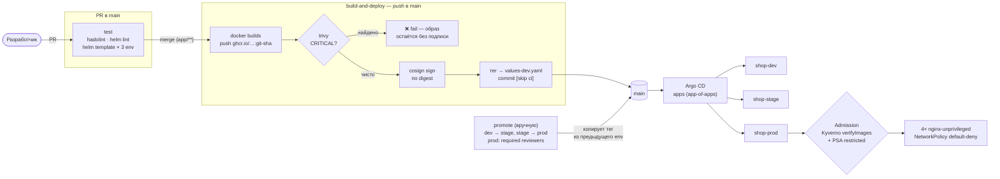

# shop-gitops

**GitOps-репозиторий для развёртывания веб-приложения в Kubernetes (k3s): CI/CD-конвейер со сборкой один раз и промоушеном dev → stage → prod, подпись образов и эшелонированная безопасность.**

Репозиторий — единственный источник правды (*single source of truth*) для приложения `shop`: описывает **что**, **как** и **с какими ограничениями безопасности** должно работать в кластере. Изменения доставляются через Git → CI → Argo CD, без ручного `kubectl apply` и `helm upgrade`.

Развёрнуто на самостоятельно собранном кластере **k3s** (Proxmox, 1 master + 2 worker), приближенном к ванильному Kubernetes: используются нативные механизмы API, а специфика k3s помечается явно.


---

## Как это работает: от коммита до пода



Ключевая идея — **build once, promote many**: образ собирается один раз на merge в `main`, получает тег `git SHA` и подпись, а дальше между окружениями перемещается только строка `image.tag` в `values-<env>.yaml`. В stage и prod попадает ровно тот же образ (тот же digest), который уже работал в dev.

Каждый деплой — это коммит в Git, поэтому история окружения читается через `git log shop/values-prod.yaml`, а откат делается через `git revert` коммита промоушена.

---

## Технологический стек

| Область | Инструменты |
|---|---|
| Оркестрация | Kubernetes (**k3s**), Helm |
| GitOps | **Argo CD**: app-of-apps, auto-sync, self-heal, prune |
| CI/CD | **GitHub Actions**, Docker Buildx, GHCR, GitHub Environments |
| Проверки в CI | **hadolint**, `helm lint`, `helm template` по всем окружениям |
| Supply chain | **cosign** (подпись образов ключом), **trivy** (скан CVE) |
| Admission | **Kyverno** `verifyImages`, **Pod Security Admission** |
| Секреты | **sealed-secrets** (шифрованные секреты в Git), шифрование Secret at rest |
| Сеть | **NetworkPolicy** (default-deny), Traefik Ingress |
| Доступность | **PodDisruptionBudget** (`maxUnavailable: 1`) |
| Образ | `nginx-unprivileged` (non-root, порт 8080) |

---

## Структура репозитория

```
.
├── app/                          # исходник приложения
│   ├── Dockerfile                #   FROM nginxinc/nginx-unprivileged:1.29-alpine
│   └── index.html
├── shop/                         # Helm-чарт (общий для всех окружений)
│   ├── Chart.yaml
│   ├── values.yaml               # база: репозиторий образа, ресурсы, флаги по умолчанию
│   ├── values-dev.yaml           # dev:   1 реплика, тег образа (правит CI)
│   ├── values-stage.yaml         # stage: 2 реплики, CPU limit 200m
│   ├── values-prod.yaml          # prod:  4 реплики, NetworkPolicy + deny egress
│   └── templates/
│       ├── deployment.yaml       # securityContext уровня restricted
│       ├── service.yaml          # :80 → targetPort 8080
│       ├── ingress.yaml          # Traefik
│       ├── networkpolicy.yaml    # default-deny ingress/egress + точечные allow
│       ├── pdb.yaml              # PodDisruptionBudget
│       └── sealed-ghcr-pull.yaml # зашифрованный pull-секрет (безопасно в Git)
├── argocd/                       # дочерние Application — по одному на окружение
│   ├── shop-dev.yaml
│   ├── shop-stage.yaml
│   └── shop-prod.yaml
├── bootstrap/
│   └── root.yaml                 # корневой Application «apps» (app-of-apps)
└── .github/workflows/
    ├── build-deploy.yaml         # test → build → scan → sign → тег в dev
    └── promote.yaml              # ручной промоушен dev → stage → prod
```

---

## CI/CD конвейер

### `build-and-deploy` — проверка и сборка

Запускается на каждый PR в `main` и на push в `main` с изменениями в `app/**`.

1. **`test`** (PR и push) — `hadolint` по Dockerfile, `helm lint` чарта, `helm template` для dev, stage и prod. Это обязательная проверка: без зелёного `test` PR не смержить.
2. **`build`** (только push, после `test`):
   - **Сборка** — `docker buildx` (`linux/amd64`), push в GHCR с тегом `github.sha`.
   - **Скан** — `trivy image` по digest; сборка **падает на `CRITICAL`**.
   - **Подпись** — `cosign sign` по digest приватным ключом (`--tlog-upload=false`, проверяется офлайн; ключ и пароль — в GitHub Secrets).
   - **Выкатка в dev** — CI записывает новый тег в `values-dev.yaml` и коммитит его с `[skip ci]`. Дальше работает Argo CD — **у CI нет доступа к кластеру**.

Образ попадает в GHCR до скана: так trivy сканирует ровно тот digest, который лежит в реестре. Подпись получает только образ, прошедший скан, а неподписанный образ Kyverno в кластер не пропустит.

### `promote` — промоушен между окружениями

Запускается вручную (`Actions → promote → Run workflow` или `gh workflow run promote -f to=prod`):

- `to=stage` — тег из `values-dev.yaml` копируется в `values-stage.yaml`;
- `to=prod` — тег из `values-stage.yaml` копируется в `values-prod.yaml`.

Джоба работает в GitHub Environment с именем целевого окружения; у `prod` включены **required reviewers**, то есть выкатку в прод нужно подтвердить. Новый образ при промоушене не собирается.

Приватность реестра: образ приватный, каждое окружение тянет его через `imagePullSecrets` → секрет `ghcr-pull`. Он лежит в Git **в зашифрованном виде** (`SealedSecret`), отдельно для каждого namespace (strict scope: шифротекст из dev нельзя расшифровать в prod).

---

## GitOps: app-of-apps

Argo CD управляет всеми тремя окружениями:

- `bootstrap/root.yaml` — корневой Application `apps`. Применяется **один раз** вручную (`kubectl apply -f bootstrap/root.yaml`), дальше Argo CD сам следит за папкой `argocd/`.
- `argocd/shop-{dev,stage,prod}.yaml` — дочерние Application: один и тот же чарт `shop/` со своим `values-<env>.yaml` и своим namespace.
- Синхронизация: `automated` + `prune` + `selfHeal` — ручные правки в кластере откатываются к состоянию из Git, удалённое из Git удаляется из кластера.
- Namespace создаётся Argo CD (`CreateNamespace=true`), PSA-метки на него ставятся через `managedNamespaceMetadata` — тоже из Git.

Добавить окружение = положить ещё один Application в `argocd/` и `values-<env>.yaml` в чарт.

---

## Безопасность: эшелонированная защита

Прод (`shop-prod`) закрыт по пяти независимым векторам — каждый ловит свою угрозу:

| Слой | Механизм | Что закрывает |
|---|---|---|
| **Образ** | `cosign` подпись по digest + Kyverno `verifyImages` (Enforce) | кластер отвергает неподписанный или подменённый образ |
| **Рантайм** | PSA `restricted` + `securityContext` | root, privilege escalation, лишние capabilities, запись в ФС |
| **Сеть** | `NetworkPolicy` default-deny (ingress + egress) | боковое перемещение; внутрь только Traefik → 8080, наружу только DNS |
| **Секреты** | `sealed-secrets` + шифрование Secret at rest | секрет в Git или на диске открытым текстом |
| **API** | `automountServiceAccountToken: false` | под не носит токен доступа к API без нужды |

`securityContext` приложения (в `deployment.yaml`):

```yaml
runAsNonRoot: true            # uid 101
seccompProfile: RuntimeDefault
allowPrivilegeEscalation: false
readOnlyRootFilesystem: true  # + emptyDir на /tmp и /var/cache/nginx
capabilities: { drop: ["ALL"] }
```

**Что из этого требует PSA `restricted`, а что сверх него.** Профиль `restricted` требует `runAsNonRoot`, `allowPrivilegeEscalation: false`, `drop: ["ALL"]` (добавить разрешено только `NET_BIND_SERVICE`) и `seccompProfile` `RuntimeDefault`/`Localhost`. `readOnlyRootFilesystem` и `automountServiceAccountToken: false` стандарт не требует — это дополнительное ужесточение.

Порт 8080 — следствие non-root, а не требование PSA: процесс без `NET_BIND_SERVICE` не может слушать порт ниже 1024, поэтому используется `nginx-unprivileged`, который по умолчанию слушает 8080.

**Про неизменяемость образа.** Тег `git SHA` уникален по соглашению, но теги в GHCR изменяемы — образ под тем же тегом технически можно перезаписать. Защиту даёт подпись: она привязана к digest, поэтому подменённый образ получит другой digest без подписи и не пройдёт `verifyImages`.

---

## Окружения

Один чарт, три профиля — различия только в `values-*.yaml` и в Application:

| | dev | stage | prod |
|---|---|---|---|
| Реплики | 1 | 2 | **4** |
| CPU limit | — | 200m | 500m |
| Memory request / limit | 32Mi / 64Mi | 32Mi / 64Mi | 32Mi / 64Mi |
| NetworkPolicy | off | off | **on (+ deny egress)** |
| Sealed pull-секрет | on | on | on |
| PodDisruptionBudget | `maxUnavailable: 1` | `maxUnavailable: 1` | `maxUnavailable: 1` |
| PSA (enforce) | `baseline` | `baseline` | **`restricted`** |
| Ingress | `dev.shop.local` | `stage.shop.local` | `shop.local` |
| Управление | Argo CD | Argo CD | Argo CD |
| Как приходит новый образ | автоматически после сборки | `promote to=stage` | `promote to=prod` + подтверждение |

Поды во всех окружениях одинаковые и соответствуют `restricted`; принудительно (`enforce`) этот уровень включён только в prod, в dev и stage — `baseline`.

---

## Известные ограничения

- **Промоутится только тег образа.** Шаблоны чарта и `values.yaml` общие, поэтому их изменение после merge в `main` попадает во все три окружения сразу. Поэтапно сейчас можно катить только то, что лежит в `values-<env>.yaml`.
- **Платформенные компоненты не в этом репозитории** (см. ниже), поэтому политику Kyverno и установку контроллеров отсюда не проверить.

---

## Что живёт в кластере (вне этого репозитория)

Репозиторий описывает приложение, его чарт и Application для Argo CD. Платформенные компоненты, на которые он опирается, установлены в кластере отдельно:

- **Argo CD** — сам контроллер; корневой Application из `bootstrap/` применён к нему вручную;
- **Kyverno** — `ClusterPolicy` проверки подписи (публичный ключ cosign на стороне кластера);
- **sealed-secrets controller** — приватный ключ расшифровки (в Git не попадает, бэкап офлайн);
- **cert-manager**, **kube-prometheus-stack**;
- **шифрование Secret at rest** — нативный `EncryptionConfiguration` на apiserver.

---

## Стенд

k3s `v1.36.3+k3s1` на Proxmox: 1 master + 2 worker (Ubuntu 24.04). Аддоны k3s (Traefik, ServiceLB, local-path, CoreDNS) помечаются как дистрибутив-специфичные; в «настоящем» кластере на их месте — облачный LB, CSI-хранилище, etcd.

---

## Автор

Богдан Белолипецкий — DevOps. Репозиторий — практический полигон по построению production-grade delivery-пайплайна и безопасности Kubernetes с нуля на собственном железе.
